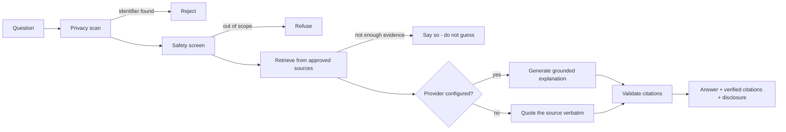

# IECMS Companion

An informational chatbot that helps members of the public understand **general**
legal terminology and court procedures used in Zimbabwe, and how to use the
**Integrated Electronic Case Management System (IECMS)**, in plain English.

> **Status: all six phases implemented.**
> The prototype is complete and verified locally. It has **not** been deployed,
> and it contains **no real legal sources** — only clearly-labelled synthetic
> test fixtures. See [Source material](#source-material) below.

## What it is and is not

IECMS Companion **may** define legal terms, explain general procedural concepts,
explain what an approved official source says, and give documented IECMS
user-guide steps with page citations.

It **must not** give personalised legal advice, recommend a strategy, predict
outcomes, or present itself as a lawyer or an official Judicial Service
Commission (JSC) service. See [`docs/SAFETY.md`](docs/SAFETY.md).

## How it works



The pipeline never fabricates. If there is no sufficient approved evidence it
says so; if the provider fails it reports a clear error; if the model invents a
citation the marker is stripped and the answer is refused if nothing valid
remains.

## Technology

| Component | Choice |
|---|---|
| Backend | Python 3.14.8, Django 6.1.2 |
| Frontend | Django templates, HTML, CSS, vanilla JavaScript |
| LLM provider | Configurable free cloud provider — Google Gemma (default), Cerebras, Groq, OpenRouter or Gemini (optional) |
| Retrieval | Local keyword inverted index (TF-IDF style) |
| Extraction | `pypdf`, `python-docx`, `beautifulsoup4` |
| Storage | **No database** for chat content, by design |

Exact pinned versions are in [`requirements.txt`](requirements.txt).

## Local setup (Windows · VS Code · PowerShell)

```powershell
code C:\Users\Administrator\Documents\iecms-companion

python -m venv .venv
.\.venv\Scripts\Activate.ps1

python -m pip install --upgrade pip
python -m pip install -r requirements.txt

Copy-Item .env.example .env
# Edit .env: set DJANGO_SECRET_KEY, and your free LLM API key.
# Default provider is Cerebras (https://cloud.cerebras.ai) — no local model needed.
# Leave the API key empty to run in quotation mode without any provider.

python manage.py migrate
python manage.py load_synthetic_corpus   # synthetic fixtures only
python manage.py runserver
```

Open <http://127.0.0.1:8000/>.

> If PowerShell blocks the activation script, run
> `Set-ExecutionPolicy -Scope Process -ExecutionPolicy Bypass` once.

### With and without an API key

| LLM API key (`CEREBRAS_API_KEY` / `LLM_API_KEY` / `GEMINI_API_KEY`) | Behaviour |
|---|---|
| Empty | **Extractive mode.** The answer is the retrieved passage quoted verbatim, labelled `DIRECT QUOTATION`, plus validated citations. |
| Set | **Generated mode.** The provider explains the retrieved evidence in plain language; citations are validated. |

Free cloud providers are configured in `.env` (see `.env.example`). No model runs
locally. Any provider other than `gemini` is treated as OpenAI-compatible and is
called at `LLM_BASE_URL` + `/chat/completions`.

### Open-web fallback

When the approved corpus cannot answer a question, the assistant falls back to
an open-web search instead of refusing. This is on by default; set
`ENABLE_WEB_FALLBACK=false` to restore the strict rule.

Web pages are filtered before they reach the model: only sentences that mention
a meaningful term from the user's question are kept, and a page that never
mentions the subject is dropped entirely. The model is also instructed to use
only the parts of the sources that address the question. A search that returns
only off-topic pages is treated as no evidence, not as an answer.

> **This relaxes the "no approved evidence, no answer" rule.** Every result is
> labelled `WEB SOURCE (UNVERIFIED)` with the exact URL, host and retrieval date,
> and is never presented as official law.

### General knowledge and the verifier panel

If the web search also finds nothing, the assistant may answer from the
configured model's general knowledge. That answer is labelled
`GENERAL KNOWLEDGE (UNVERIFIED)` and always carries a notice that it is not an
approved source.

Before either a web-based or general-knowledge draft is shown, three reviewer
agents read it using the **same configured model**:

- `grounding` — checks claims against the web evidence, or checks that a
  general-knowledge answer is hedged and invents no citations, dates or section
  numbers;
- `safety` — checks the no-legal-advice boundary and official-status claims;
- `clarity` — checks that the answer addresses the question and is coherent.

The panel can approve the draft, return a corrected revision (which is verified
again, at most `VERIFICATION_MAX_ROUNDS` times), or reject it. If a reviewer
cannot be reached or returns an unusable reply, the draft is **not shown**.
This is a plausibility and safety review, not a fact-checking service.
`ENABLE_ANSWER_VERIFICATION` and `ENABLE_GENERAL_KNOWLEDGE_FALLBACK` control
the two features; both need a configured model. Without one, the assistant
keeps the strict refusal behaviour.

Answers are written in plain English. There is no language selector and no
translation step: the text you read is the grounded English answer itself.

The visible conversation lives in the browser tab's memory only. It is never
stored on the server, in `sessionStorage` or in a cookie; refreshing the page
starts a new conversation.

### IECMS user-guide assistant

IECMS how-to questions ("How do I file a case?", "How do I reset my
password?", "How do I add the parties?") are answered from the approved
**IECMS Getting Started Guide — Public Users, Version 1.1 (2021)**. The guide is
a scanned PDF, so ingestion uses OCR (`pymupdf` + the Windows OCR engine via
`winocr`). The OCR packages are optional: without them the app still runs, and
the manual ingest reports a clear warning instead of inventing text.

```powershell
# One-time (or after changing the manual): OCR + extract + index.
.\.venv\Scripts\python.exe manage.py ingest_sources --manifest legal_sources\manifests\iecms-manuals.json

# Verification is a deliberate human act. The supplied manual was recorded as
# verified on 2026-10-18; re-run this after any re-ingest.
.\.venv\Scripts\python.exe manage.py verify_source zw-iecms-user-manual --date 2026-10-18
```

Manual answers:

- cite the manual title and PDF page number;
- give numbered steps when the manual documents an ordered procedure;
- carry a notice that the 2021 interface may differ from the live IECMS;
- search the web only when the manual has nothing, and label any result
  unverified (never present a web page as documented manual steps);
- never claim to file, sign, merge, submit or pay for anything.

Follow-up questions work without repeating the original wording. The browser
sends only the last few **questions** (not answers) with each request; the
backend uses them to resolve context and does not store them.

Document summaries are available through the **Upload document** button.
Supported formats are PDF, DOCX, plain text, Markdown and HTML, up to 5 MB
(configurable with `DOCUMENT_SUMMARY_MAX_BYTES`). The file is parsed from a
temporary path and deleted immediately; it is never stored. Summaries require a
configured language-model provider; without one the assistant says so honestly
and does not return a fake summary. A summary comes from the user's own file,
not from the approved sources, and is labelled accordingly.

Add further approved manuals to
`legal_sources/manifests/iecms-manuals.json` (set `"ocr": true` for scans) and
list their source ids in `IECMS_MANUAL_SOURCE_IDS`.

## Commands

```powershell
# Tests
.\.venv\Scripts\python.exe manage.py test

# Corpus management
.\.venv\Scripts\python.exe manage.py load_synthetic_corpus
.\.venv\Scripts\python.exe manage.py build_index
.\.venv\Scripts\python.exe manage.py ingest_sources --manifest legal_sources\manifests\real-sources.json
.\.venv\Scripts\python.exe manage.py ingest_sources --manifest legal_sources\manifests\iecms-manuals.json
.\.venv\Scripts\python.exe manage.py verify_source <source_id> --date 2026-10-12
```

See [`docs/ADDING_SOURCES.md`](docs/ADDING_SOURCES.md) for the full procedure.

## Source material

**Important.** The JSC website (`www.jsc.org.zw`) was **not reachable** from the
development environment — all requests timed out. No attempt was made to work
around that, and no page contents were invented.

Instead, a **definitions corpus** can be ingested from
`legal_sources/manifests/real-sources.json`: official local copies of
legislation, court rules, a practice direction, a court form and the IECMS user
manual.

```powershell
.\.venv\Scripts\python.exe manage.py ingest_sources --manifest legal_sources\manifests\real-sources.json
```

Each entry must still be verified by an authorised person before it may ground
an answer. Three entries are scanned images with no text layer and need OCR
first. Until sources are verified, questions about real topics correctly return
"the approved material does not establish a reliable answer". The bundled
synthetic fixtures remain for tests only and are labelled as synthetic
everywhere they appear.

See [`docs/SOURCE_POLICY.md`](docs/SOURCE_POLICY.md).

## Documentation

- [`docs/ARCHITECTURE.md`](docs/ARCHITECTURE.md) — components, data flow, known limitations
- [`docs/SOURCE_POLICY.md`](docs/SOURCE_POLICY.md) — source approval and currency
- [`docs/ADDING_SOURCES.md`](docs/ADDING_SOURCES.md) — how to add and verify documents
- [`docs/PRIVACY.md`](docs/PRIVACY.md) — data handling and limitations
- [`docs/SAFETY.md`](docs/SAFETY.md) — legal-information boundary
- [`docs/SECURITY.md`](docs/SECURITY.md) — security review and deployment caveats
- [`docs/TESTING.md`](docs/TESTING.md) — test and evaluation guide

## Phase status

| Phase | Scope | Status |
|---|---|---|
| 1 | Project, settings, interface, mock chat | Complete |
| 2 | Metadata, extraction, ingestion, approval, local search | Complete |
| 3 | Retrieval-grounded explanations, citation validation | Complete |
| 4 | Privacy, legal safety, speech | Complete |
| 5 | Automated, adversarial and evaluation tests | Complete |
| 6 | Security, documentation, readiness review | Complete |

## Contributing safely

Do not commit real court documents, confidential material or API keys. Do not
describe the privacy detector as anonymisation — it is a heuristic and
incomplete. Do not claim a test passed without running it.
