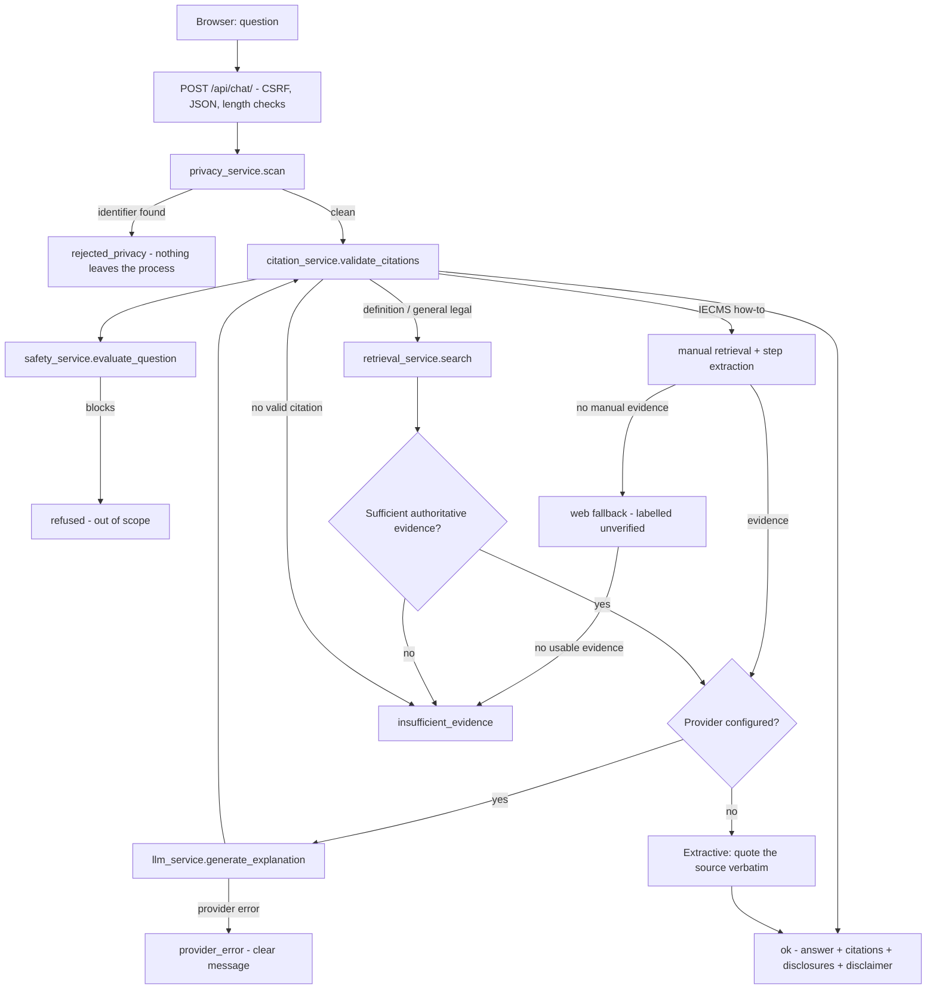

# Architecture

## Overview

IECMS Companion is a single Django application. The browser talks only to the
Django backend, and the backend is the only component that may contact an
external provider. There is no separate frontend framework, no microservice, no
mandatory authentication and no chat database.

## Components

| Component | Responsibility |
|---|---|
| `chatbot/views.py` | HTTP only: JSON shape, method, CSRF, error mapping |
| `chatbot/forms.py` | Input validation and length limits |
| `chatbot/constants.py` | Non-secret shared wording |
| `chatbot/services/explanation_service.py` | Orchestrates the whole pipeline |
| `chatbot/services/privacy_service.py` | Personal-identifier detection (heuristic) |
| `chatbot/services/safety_service.py` | Advice boundary and model instructions |
| `chatbot/services/retrieval_service.py` | Search over approved sources; scoped legal and IECMS-manual collections |
| `chatbot/services/intent_service.py` | Deterministic routing between definitions, IECMS how-to, manual-section, summary and unsupported questions; resolves bounded follow-ups |
| `chatbot/services/procedure_service.py` | Extracts numbered steps from manual passages or generated answers |
| `chatbot/services/llm_service.py` | Cloud LLM provider access (Gemini, or any OpenAI-compatible endpoint such as Cerebras) |
| `chatbot/services/web_search_service.py` | Open-web fallback search (on by default); every result is labelled unverified |
| `chatbot/services/citation_service.py` | Citation validation |
| `legal_sources/metadata.py` | Source metadata and verification states (including the opt-in `ocr` flag) |
| `legal_sources/extraction.py` | Text extraction with page/heading references; OCR paragraphing |
| `legal_sources/ocr.py` | Optional OCR for scanned PDFs (PyMuPDF rendering + Windows OCR) |
| `legal_sources/indexing.py` | Local inverted index |
| `legal_sources/ingestion.py` | Local files and approved URLs |
| `legal_sources/manifests.py` | Ingestion manifests |
| `legal_sources/management/commands/` | `ingest_sources`, `build_index`, `verify_source`, `load_synthetic_corpus` |
| `config/test_runner.py` | Test runner that blocks outbound network access |

`views.py` contains no prompt text, no retrieval logic and no provider code. No
service module imports HTTP machinery, so every service is unit testable.

## Request flow



## Grounding guarantees

1. **No evidence, no answer.** The provider is never called without retrieved
   passages. Without sufficient evidence the response is a refusal — unless the
   open-web fallback is enabled (the default), in which case the answer is
   labelled `WEB SOURCE (UNVERIFIED)` and carries each page's URL. IECMS how-to
   questions prefer the approved manual; when the manual has nothing they use
   the same clearly-labelled unverified fallback rather than inventing steps.
2. **No unapproved evidence.** Only `verified` sources qualify, plus `synthetic`
   fixtures when explicitly enabled — and synthetic use is always disclosed.
3. **No invented citations.** Answers are validated against the labels actually
   supplied. Fabricated markers are stripped; if nothing valid remains, the
   answer is not shown as grounded.
4. **Documents are data, not instructions.** The system instructions state that
   sources are untrusted and that embedded instructions must be ignored.
5. **Nothing fabricated on failure.** Provider errors surface as explicit
   errors, never as an invented answer.

## Response statuses

| Status | Meaning |
|---|---|
| `ok` | Generated, citation-validated answer |
| `extractive` | Verbatim quotation of a retrieved source (no provider configured) |
| `web_fallback` | Built from an unverified open-web search, disclosed with each URL |
| `insufficient_evidence` | Approved material does not establish an answer |
| `refused` | Request crossed the safety boundary |
| `rejected_privacy` | Apparent personal identifiers; nothing was sent anywhere |
| `provider_error` | Provider unavailable, rate-limited, timed out or misconfigured |
| `mock` | Development placeholder (`ENABLE_MOCK_CHAT=true`) |

## Extractive mode

If no provider is configured the pipeline does not guess. It quotes the
retrieved passage verbatim, labels the answer `DIRECT QUOTATION`, and states
that no explanation engine is configured. This keeps the prototype usable and
demonstrable without misrepresenting generated text as a quotation or vice
versa. Disable with `LLM_ALLOW_EXTRACTIVE_FALLBACK=false`.

Answers are always written in plain English. Earlier versions offered a Shona
translation; that path has been removed, so no translation provider, key or
setting is involved in producing an answer.

## Conversation state in the browser

The visible conversation is kept in memory for the life of the page. It is not
written to `sessionStorage`, `localStorage` or a cookie, and nothing is stored
on the server. Each request may carry the last few questions (not answers) so
the backend can resolve follow-ups; that context is used for the request only
and is not persisted.

## Providers

The provider that writes the grounded answer is configured with
`LLM_PROVIDER`, `LLM_MODEL`, `LLM_BASE_URL` and `LLM_API_KEY`. The default is
Google Gemma (free). If no key is configured the pipeline falls back to
extractive mode rather than guessing.

## Retrieval

A keyword inverted index with TF-IDF-style scoring, stored as JSON at
`legal_sources/index/index.json`. Retrieval reports a `confidence` based on how
much of the question the best passage covers; a partial match (`low`/`medium`)
is disclosed to the user rather than presented as a good answer.

**Known limitation.** Keyword search can match an incidental word. A question
about court fees may match a passage containing the unrelated word "dispute".
The passage is still a genuine quotation from a real stored source and the
source is displayed, but it may not address the question. The retrieval
interface is modular so hybrid or vector retrieval can replace the
implementation without touching the chat application.

## Data layout

No Django models. Corpus state lives in files:

```
legal_sources/
  manifest.json          synthetic fixtures manifest      (committed)
  manifests/             real-sources + iecms-manuals     (committed)
  synthetic/*.md         synthetic fixtures                (committed)
  registry.json          metadata + verification status    (committed)
  documents/             downloaded originals              (git-ignored)
  extracted/*.json       extracted blocks                  (git-ignored)
  index/index.json       keyword index                     (git-ignored)
```

A database will only be introduced if source metadata or operational data
justify it, and the decision will be documented first.

## Key decisions

- **Staged honesty.** Every guarded branch returns an explicit status rather
  than a plausible-looking answer.
- **Explicit statuses in the payload**, so the interface and the tests can tell
  a real grounded answer from a quotation, a refusal or an error.
- **Synthetic sources require explicit opt-in** and are refused by
  `load_synthetic_corpus` when disabled.
- **Service stubs never returned empty results.** Where a capability did not
  exist yet it raised, so an empty result could never be mistaken for "no
  evidence found".
- **Answers are inserted as text, never HTML** (`textContent`).
- **Credentials stay server-side.** No key is rendered into a template or sent
  to the browser.
- **Tests cannot reach the network.** A custom test runner disables the provider
  SDK and `urllib.request.urlopen` (see `docs/SECURITY.md` for why).

## Deliberately deferred

Direct IECMS integration, automated interaction with the IECMS portal, vector
or hybrid retrieval, speech recognition, user accounts and chat history.
